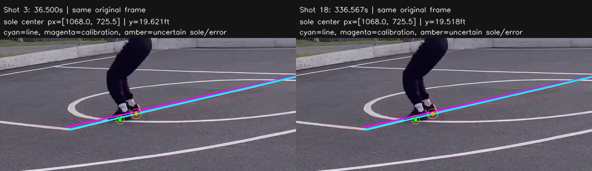

# 실제 접지점·자유투선 비교 검증 — 2026-11-04

## 결과

14구역 경계 정책을 유지한 상태에서, 원본 신발 접지 픽셀과 실제 관측한 자유투선을 분리해 비교하는 절차를 구현했다. 자유투선 근처의 두 발 점프슛에 조건부로 연결했으며 기존 YOLO·슛 종류·득점 판정은 유지한다.

3번과18번은 시간 정렬 뒤 신발 두 개의 평균 화면 좌표가 같았다. 각 장면에 저장된 변환 행렬을 적용한 좌표 차이는 약3.65cm였다. 그러나 뒤쪽 신발의 가림·낮은 접지점 신뢰도와 자유투선 안팎을 걸치는 오차 때문에 **두 장면 모두 위치 보류**다. 이것은 원인 분리와 일관된 보류의 검증이며, 실제 위치 정답을 자동 확정했거나 전체 정확도가 개선됐다는 뜻이 아니다.

기존 운영 기록30개와 원본 결과 파일은 보존했다. 아래 새 판정의 저장 검증은 별도 SQLite에서 수행했다. 실행 중 작업0개 확인 후 백엔드를 새 코드로 재시작했고 프론트·백엔드는200이다. 이후 새 분석부터 이 절차를 사용한다.

## 실행한 절차

1. **접지 장면 확보:** 기존 자세 궤적에서 얻은 안정 시각은 시간·크롭 위치를 찾는 참고로만 사용한다. `sole_pixels` 고정 범위는 이 시각의 -400/+200ms다. 점프 직전 약0.5초와 떠오르는 장면을 함께 포함한다. 원본60fps에서 장면별36프레임을 연속 디코딩했다. AI에는 약30fps에 해당하는 원본 크롭19장과 전체 구도1장을 제공했다. 신발 크롭은 PNG이며 확대·축소하지 않았다.
2. **실제 선 관측:** 저장된 변환으로 예상 자유투선 주변을 찾되, 실제 흰 픽셀의 연속성·길이·잔차를 검사해 선을 따로 맞춘다. 사람 영역은 선의 근거에서 제외한다. 선을 찾지 못하면 예상 선을 관측 선으로 대체하지 않는다.
3. **가려진 선 보완:** 다른 시각의 선은250ms 이내에서만 빌린다. 해당 프레임들의 특징 대응뿐 아니라 바닥 기준점 패치가 일치해야 한다. 모든 사용 프레임은 기준 변환을 검증한 릴리스 장면과 바닥/구도가 맞고 기준점 이동이2px 이하여야 한다. 다른 구도나 검증 실패 프레임은 접지 측정에 쓰지 않는다.
4. **신발 픽셀 표시:** Terra는 각 프레임의 두 발 접지/한 발 접지/공중/불명 상태와 실제 밑창 접촉 중심의 크롭 좌표, 픽셀 오차, 접지점 신뢰도만 반환한다. 구역 이름과 코트 XY를 추정하도록 요구하지 않는다. 코드가 크롭 원점을 한 번 더해 원본 픽셀로 바꾼다. 아래 표시는 AI가 선택한 점이며 사람이 기록한 정답이 아니다.
5. **오차 포함 판정:** 점프 직전 연속된 접지 프레임3개 이상·60ms 이상, 두 신발 각각70% 이상, 실제 공중 프레임으로 점프 확인, 안정된 좌표와 검증된 선이 필요하다. 접지점 픽셀 오차·관측 선 잔차·구도 대응 오차를 환산 범위에 포함한다. 추가 픽셀 오차2px와4px 조건도 함께 계산해 두 조건 모두 같은 쪽이어야 한다.
6. **좌표 저장 또는 보류:** 여러 프레임에서 두 신발의 환산 오차 범위가 모두 자유투선 바깥이면 미드레인지, 모두 안쪽이면 페인트존으로 저장한다. 안팎에 걸치거나 증거가 부족하면 위치만 보류한다. 구역 이름은 저장 XY로 계산하고 마커를 경계 너머로 옮기지 않는다.

2px/4px는 민감도 비교를 위한 명시적 오차 가정이다. 실제 수동 기준점 오차 전체를 측정한 통계적 신뢰구간이 아니다. 자동 확정률과 실제 정확도를 확인하려면 사람이 표시한 접지점·선 정답이 추가로 필요하다.

## 3번·18번에서 어느 단계가 달랐나

| 비교 | 3번 | 18번 |
| --- | --- | --- |
| 저장된 릴리스 시각 | 36.933초 | 337.067초 |
| 기존 자세 기반 참고 접지 시각 | 36.533초 | 336.533초 |
| 실제 같은 화면의 비교 프레임 | 2190번·36.500초 | 20194번·336.567초 |
| AI가 짚은 두 신발 평균 원본 픽셀 | `(1068.0, 725.5)` | `(1068.0, 725.5)` |
| 각자 저장된 변환을 적용한 평균 좌표(ft) | `(19.674, 19.621)` | `(19.735, 19.518)` |
| 비교 프레임 뒤쪽 신발 신뢰도 | 65% | 61% |
| 최종 접지 후보4프레임의 뒤쪽 신발 신뢰도 범위 | 60~65% | 58~61% |
| 비교 프레임의 두 신발 y 오차 전체 범위(ft), 2px 조건 | 18.216~20.696 | 18.129~20.578 |
| 자유투선 기준 | y=19 | y=19 |
| 새 위치 판정 | 보류 | 보류 |

- 영상의 반복 간격을 정확히 맞추면18004프레임, 즉300.0667초 차이다. 단순히300초만 더하면4프레임이 어긋난다. 비교한 전체1920×1080 프레임의 픽셀 평균 절대 차이는0이었다.
- 기존 참고 시각은 이4프레임 차이를 반영하지 않았다. 새 연속 장면은 양쪽에서 최종 접지/공중 전환을 함께 찾는다. AI가 고른 점프 시작은2196번과20200번으로 똑같이18004프레임 차이다.
- 신발 픽셀 두 개의 평균은 같으므로, 이 비교에서 남은3.65cm의 중심 좌표 차이는 두 검증 변환 행렬의 차이에서 생겼다. 검증된 구도 변환도 매번 작은 차이가 있을 수 있다. 이번 작업에서는 그 변환을 임의로 합치거나 기존 기준점을 수정하지 않았다.
- 두 장면 모두 앞쪽 신발에 가려진 뒤쪽 밑창 접촉을 충분한 신뢰도로 확인하지 못했다. 또한 진단용 좌표의 오차가 자유투선 안팎에 걸쳐 있다. 70% 기준을 낮추거나 낮은 점수를 평균으로 올리지 않았다.

## 표시 이미지

- 청록색: 실제 흰 픽셀로 관측한 자유투선.
- 자홍색: 저장된 코트 변환이 예측하는 자유투선.
- 초록 점:70% 이상인 AI 신발 접촉점.
- 주황 점·원: 낮은 신뢰도의 접촉점 또는 픽셀 오차 범위. 정답 표시가 아니다.

원본 전체 표시 이미지:

- `backend/work/verification-2026-11-04/sole-contact-3-18-floor-verified/shot03/annotated-2190.png`
- `backend/work/verification-2026-11-04/sole-contact-3-18-floor-verified/shot18/annotated-20194.png`

## 서비스 연결과 저장 검증

- 현재 구현 범위는 **자유투선 근처 두 발 점프슛**이다. 검증된 코트·자세 근거가 있고, AI 위치 또는 접지 참고 환산값이 페인트존 가로 범위의 자유투선 ±2ft에 있을 때 측정한다. 레이업·덩크·영상에서 확인된3점슛은 이 절차로 판정을 덮어쓰지 않는다. 다른 물리 경계는 기존 엄격한 검토를 유지한다.
- 실제 선을 충분히 관측하지 못하면 추가 유료 호출 없이 위치를 보류한다. 조건을 만족하는 경우에만 신발 픽셀 판정1회를 추가한다. 실패·가림·좌표 오차는 슛 종류·득점 실패로 확대하지 않는다.
- 측정 근거와 원래 정책 결과는 `ai_review.sole_contact`, `model_decisions.pre_contact_policy`, `position_evidence_source`에 남는다. 기존 `plant_reference_is_measured_contact=false`는 사람 상자 하단의 참고 투영을 설명하는 값으로 유지한다. 실제 신발 측정과 혼용하지 않는다.
- 새 유료 응답2개를 저장한 뒤 운영 `review_candidates_with_openai`를 원본 영상과 함께 재현했다. 추가 API 호출 없이 실제 준비·검토·판정·`materialize_shots_from_candidates` 저장까지 별도 SQLite에서 실행하고 다시 조회했다.
- 두 기록 모두 슛 시도·성공·드리블 풀업을 보존하고, 위치만 `needs_review`/빈 XY로 저장됐다. 기존 운영3번은 그대로 정면 미드레인지 좌표를 유지하고 기존18번도 기존 보류 상태다. 기존 화면이 자동으로 이 시험 결과로 바뀌지는 않는다.

## 소요 시간·토큰

- 새 Terra 호출은 **2회**, 입력 **14,644**·출력 **1,744**·합계 **16,388토큰**이었다. 모델 상승과 YOLO 재학습은 하지 않았다.
- 최초 실제 영상 시험 전체 **34.39초**, API 응답 합계 **32.37초**다. 이후 강화된 바닥 검증·오차 계산은 저장된 같은 응답으로 재현했으며 추가 토큰은 없다. 로컬 재검증은 약5.11초였다.
- 운영 흐름 재현도 추가 유료 호출0회다. 저장된 응답의 원래 토큰을 새 호출로 중복 합산하지 않았다. 이 시간은10분 영상 전체 분석 시간이 아니다.

## 자동 시험과 미확인 범위

- 접지·선 전용29개 시험 포함 백엔드 전체 **491개** 통과.
- 프론트 **40개**·빌드 통과. 기존14구역의 실제2D·3D 경계 시험도 유지된다.
- 실제 선 없는 장면, 구도 이동, 바닥 검증 실패, 근거 없는 선 재사용, 날조/중복 프레임, 공중 발, 발 가림/낮은 신뢰도, 한 프레임만 있는 경우, 접지점 흔들림, 신발/선 오차가 경계를 넘는 경우를 검사했다. 추가 호출 사용량 합산과 슛 종류·득점 보존도 검증했다.
- Chrome 직접 조작, 새10분 전체 유료 재분석, 사람이 지정한 신발/선 정답을 통한 실제 위치 정확도 검증은 이번에 하지 않았다. 기능은 원본 증거를 구체화하고 불확실성을 일관되게 처리하는 단계다.
- 커밋/푸시는 이번 요청에 없어 수행하지 않았다.

## 남은 순서

1. 표시 이미지에서 실제 접촉점과 자유투선을 사람이 확인해 정답 자료를 확보한다. 가려진 신발은 정답을 추측하지 않는다.
2. 같은 고정 구도로 검증된 장면의 코트 변환에 남는 미세 흔들림을 별도 시험한다. 이번 비교의3.65cm를 줄이는 과제이며 임의 마커 이동으로 처리하지 않는다.
3. 위치가 선에서 충분히 떨어진 별도 실제 영상도 같은 측정으로 확인해 자동 확정이 정상 동작하는지 검증한다. 합성 자료의 성공을 실제 영상 성공으로 대체하지 않는다.

증거 요약: `backend/evaluation/results/sole-contact-2026-11-04.json`. 새 응답 원본은 `backend/work/verification-2026-11-04/sole-contact-3-18/report.json`, 바닥 검증/오차 비교는 `sole-contact-3-18-floor-verified/report.json`, 운영 저장 재현은 `sole-contact-production-replay-final/summary.json`과 같은 폴더 `replay.sqlite`다. 재현 스크립트는 기존 출력 폴더를 덮어쓰지 않는다.
